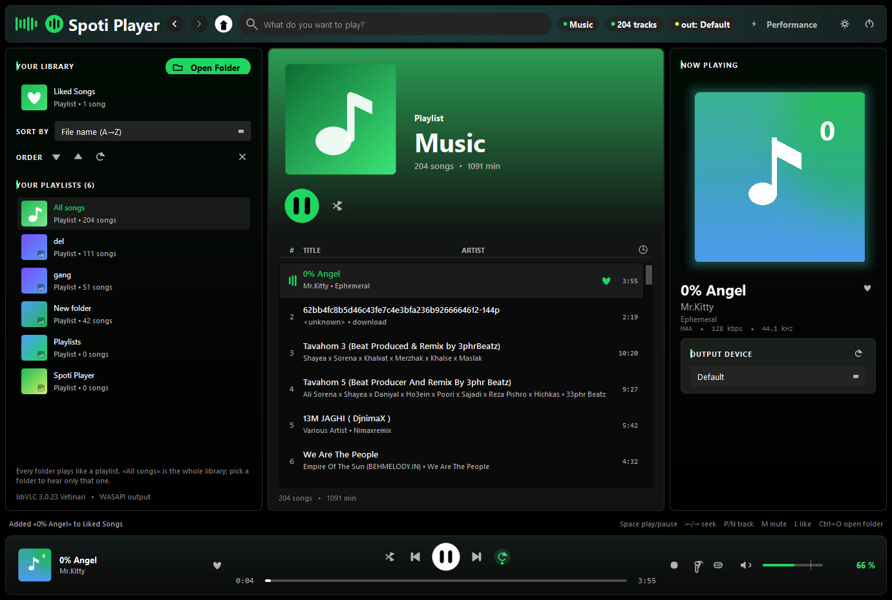
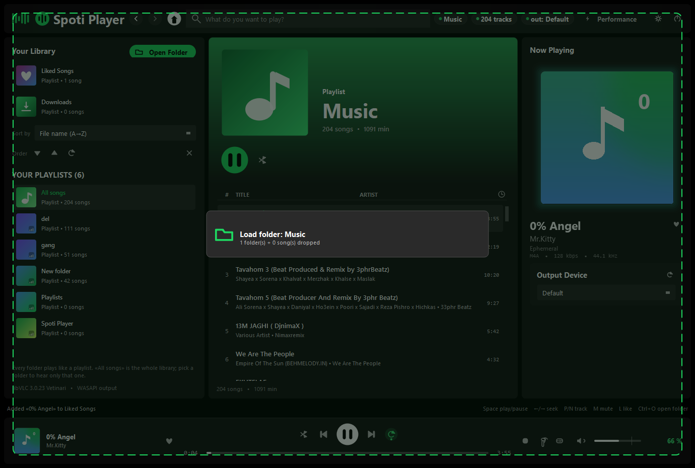

# 🎧 Spoti Player

A desktop music player for Windows with a pixel-faithful Spotify interface, built with **Python + Qt 6 (PySide6)** and powered by **libVLC**.



Black frame, flat `#121212` panels separated by 8 px gaps, the brand green `#1ED760`, a white circular play button, folders drawn as Spotify playlists, a bottom play bar and a full radio section — all hand-painted with `QPainter`, no web view, no external theme files.

---

## Features

| | |
|---|---|
| 📂 **Open a folder** | Button, dialog, or simply drag a folder onto the window |
| 🗂️ **Folders as playlists** | Each folder is drawn like a Spotify playlist: gradient cover tile, name, `Playlist • n songs` |
| 🎧 **Spotify look** | `#000000` frame, `#121212` panels, `#181818` cards, borderless 8 px rounded surfaces, brand green `#1ED760` |
| 🔤 **Natural sort** | Windows-style ordering: `1` → `2` → `10` → letters |
| 🔀 **Ordering** | 9 sort modes, shuffle, manual move with ↑ ↓ or the context menu |
| 🔊 **Volume drive** | 0–125 % slider with a 100 % marker and boost colouring |
| 🔍 **Search (local + online)** | Filters your own list and fetches any other song from Apple Music with a 30-second preview and a **full-song download** |
| 🧭 **Back / Forward / Home** | Navigation history across folders, playlists and Liked Songs |
| ♥ **Liked Songs** | Heart button, `L` key, right-click on a track, and a pinned playlist above the library list |
| 🖥️ **Output device** | Lists WASAPI devices and switches **while playing** |
| 🖼️ **Album art** | Embedded cover or folder `cover.jpg`, disk-cached, with a generated gradient fallback |
| 🟣 **Discord Rich Presence** | "Listening to …" with a live timer |
| 📻 **Radio (54 stations)** | lofi.radio, SomaFM, FIP, Radio Paradise, Nightride FM and Radio Swiss in 8 categories — including relaxing stations **with vocals** |
| ✨ **Song-change animations** | Cover fade, accent colour morphing from the new cover, list row flash |
| ⚡ **Performance mode** | Every animation off, one refresh per second, lowest CPU/GPU usage |
| 🪟 **Always-on-top mini bar** | Slim bar at the top centre with cover, title, progress; clicks pass through everywhere except its own buttons |
| 🖥️ **System tray** | Closing the window while playing keeps the music running in the tray |
| 📦 **Single-file exe** | `build_exe.bat` produces `Spoti Player.exe` |

---

## Screenshots

| Main window | Mini bar | Drag & drop |
|---|---|---|
|  |  |  |

---

## Installation

Requirements:

1. **Windows 10/11** and **Python 3.10+**
2. **VLC media player 64-bit** (provides `libvlc.dll`) — <https://www.videolan.org/vlc/>
3. Python packages:

```bat
pip install -r requirements.txt
```

## Running

Double-click **`SpotiPlayer.bat`** (it finds a working Python and installs the packages), or:

```bat
pip install -r requirements.txt
python main.py
```

Command-line options:

```bat
python main.py --folder "D:\Music"     :: start with a folder loaded
python main.py --mini                  :: start with the always-on-top mini bar
python main.py --devices               :: list audio output devices
python main.py --discord-id 123...     :: store a Discord Application ID
```

---

## Drag & drop

Grab folders or song files in Explorer and drop them **onto the window**:

| You drop | Result |
|---|---|
| One **folder** | That folder is loaded (scanned, sub-folder card shown) |
| **Several folders** | The first one is loaded, the songs of the rest are appended |
| **Song files** (one or many) | **Added** to the current playlist without clearing it |
| A folder **and** songs | The folder is loaded and the songs are added as well |

While dragging, a dashed overlay plus a hint card show what is about to happen. Duplicate songs are skipped and paths are normalised, so `/` separators work too.

---

## Folders are Spotify playlists

When a loaded folder **has sub-folders**, a **Your Playlists** card appears between the tools and the track list, and every folder is drawn exactly like a Spotify playlist: a rounded gradient cover, the playlist name and a `Playlist • n songs` subtitle.

* Each cover comes from a stable Spotify brand gradient, derived from the folder name.
* The selected playlist gets a **green name**, like the playlist currently playing in Spotify.
* The number of songs is shown next to every folder.
* The choice is **remembered per folder**.
* The card's height follows the number of playlists, so there are no half rows.
* With no sub-folders the card is not shown at all.

---

## Mini bar


| Action | Result |
|---|---|
| Mini-bar button in the transport row (or tray menu → *Mini bar on top*) | The bar appears at the top centre of the screen |
| `Spoti Player.exe --mini` | The app starts with the mini bar |
| Click ⏸/▶ or ⏭ | Play/pause and next track |
| Mouse wheel over the bar | Next / previous track |
| **Drag the bar by its cover** | Moves it (its position is saved) |
| Double-click the bar | The main window comes back |
| ✕ on the bar | Closes the bar (it stays until you close it) |
| Click anywhere else on the bar | **Passes through** to the app underneath |

### It never steals your clicks

Only the three buttons and the cover (for dragging) accept the mouse. The rest of the bar uses `WS_EX_TRANSPARENT`, so clicks reach the window below: even when the bar sits over another app's title bar, that app's close / minimise / fullscreen buttons keep working. (`WindowFromPoint` returns the window underneath across the text area and the bar itself over its buttons.)

### Staying visible above a game

The bar is created with `WS_EX_TOPMOST | WS_EX_TOOLWINDOW | WS_EX_NOACTIVATE` and re-raises itself every 0.7 s (and every 60 ms right after being hidden) with `SetWindowPos(HWND_TOPMOST)` **and then** `SetWindowPos(HWND_TOP)`. The second call is the important one: `HWND_TOPMOST` does nothing for an already-topmost window, while `HWND_TOP` really puts the bar at the top of the top layer without stealing focus.

> ⚠️ The game has to run in **borderless / windowed fullscreen**. True *exclusive* fullscreen games send their image straight to the display and Windows hides every normal window, so no regular app — this bar included — can be drawn over them. If the bar stays hidden, the app posts a tray notification.

---

## Radio (54 stations)

The 📻 button in the transport row (or tray menu → **Radio**) opens a categorised station menu; every station starts with one click.

| Category | Stations |
|---|---|
| **Chill & Lofi** | lofi.radio, Groove Salad, Lush, I Love Chillhop, laut.fm Lo-Fi, laut.fm Chillout |
| **Relax & Vocals** | Bossa Beyond, SomaFM Covers, Radio Swiss Jazz, Radio Swiss Pop, Illinois Street Lounge, Secret Agent, Seven Inch Soul, FIP Pop, laut.fm Chillradio |
| **Ambient & Space** | Drone Zone, Deep Space One, Space Station Soma, Mission Control, SF 10-33 |
| **Electronic** | Beat Blender, The Trip, PopTron, Fluid, cliqhop idm, DEF CON Radio, FIP Electro, Vaporwaves |
| **Indie & Rock** | Indie Pop Rocks!, Underground 80s, Digitalis, Left Coast 70s, Folk Forward, Boot Liquor, FIP Rock, FIP Metal, Radio Paradise Rock Mix |
| **Jazz & Soul** | Sonic Universe, FIP Jazz, FIP Groove, FIP Hip-Hop |
| **World & Eclectic** | Radio Paradise, Mellow Mix, Global Mix, Suburbs of Goa, FIP World, FIP Reggae, FIP, FIP Nouveautés |
| **Synthwave** | Nightride FM, Chillsynth FM, Darksynth FM, Datawave, Spacesynth |

* **Relax & Vocals** is the calm category for when silence-free is not a requirement: bossa nova, mellow covers, vocal jazz, vintage soul and lounge.
* **lofi.radio** songs are streamed one by one and shuffled, exactly like the site plays them; the other stations are continuous 24-hour streams.
* On a live stream, next / previous switches station (there is no "next song"); on lofi.radio it moves through the song list.
* Clicking the radio button again stops playback (or use *Stop radio* at the end of the menu).
* The last station is stored in the settings and restored on the next launch.
* While the radio plays, the mini bar gets a **locally generated live wallpaper** for that station family — rain, starfield, neon, embers, bokeh, aurora or synthwave. Nothing is downloaded or cached: every frame is painted with `QPainter`, and in performance mode it stays on one static frame.

---

## Online search (any song, even one that is not on your PC)

Type anything into the search field — song, artist or album. After two characters the app queries the **Apple Music catalogue** and an **Online Songs** section opens under the playlist:

| Action | Result |
|---|---|
| Click a row | Streams that song's **30-second preview** immediately |
| The ⬇ button on the right of a row | Downloads the **whole song** in the background into *Downloads* |
| Next / previous buttons | Move through the online results |
| Right-click → *Download the full song* | Same as the ⬇ button |
| Right-click → *Play the downloaded song (offline)* | Plays the saved full version |
| Right-click → *Open the full song in Apple Music* | Opens the official song page in the browser |
| Right-click → *Copy the Apple Music link* | Copies the official link |

Notes:

* **No account and no API key:** the public iTunes Search API is used.
* **Downloads are full songs, not previews:** the complete file is fetched from the public Audius catalogue and — through `yt-dlp` — from SoundCloud and YouTube, then stored in `%APPDATA%\SpotiPlayer\Downloads` with tags and cover art, playable offline at full length. If Audius has no match and `yt-dlp` is missing, the app says `pip install yt-dlp`.
* **Wrong results are rejected:** any match whose duration disagrees with the original (30-second clips, slowed/sped-up versions, remixes, hour-long sets) is skipped and the next candidate is tried, so no half or 30-second file lands in Downloads.
* **Preview streams, download is complete:** clicking a row still streams the official 30-second Apple Music clip; only the download is the full song.
* **The search field does two jobs:** it filters your own list and brings in online results; clearing it restores the local list.
* **Search view:** while a search is open the big playlist hero steps aside so the results get room (up to three full rows; on a shorter window fewer rows with scrolling, never a clipped row).
* **Covers and dynamic colour:** each result's cover is downloaded in the background and cached in `%APPDATA%\SpotiPlayer\artcache`, so it is not fetched twice.
* **In sync with the rest:** mini bar, Discord Rich Presence, the bottom play bar and play/pause all treat an online preview like a local track.
* **Offline?** If the catalogue cannot be reached, the online section says *Could not reach the online catalogue* and local playback plus radio keep working.

---

## Bottom play bar

The transport has moved to the **bottom edge of the whole app**, exactly like Spotify's play bar:

| Side | Contents |
|---|---|
| **Left** | Small rounded cover (tinted by the song) + title + artist (elided with "…") + ♥ |
| **Middle** | Shuffle, previous, **white circular play**, next, repeat — and below them the current time, the seek bar and the total duration |
| **Right** | Stop, mini bar, speaker icon (mute with `M`) + **Spotify-style volume slider** + percentage (up to 125 %) |

* The right panel is now purely "Now Playing": large cover, title / artist / album / technical line and the output device card.
* All the old keyboard shortcuts (`Space`, `P`/`N`, `↑`/`↓`, `M`, `L`) still work.

---

## Theme and colours

The interface is all Spotify: a `#000000` frame, `#121212` panels and columns separated by 8 px gaps, `#181818` cards, `#2A2A2A` hairlines, white / grey text (`#FFFFFF` / `#B3B3B3`) and the brand green `#1ED760` as the main accent. Panels are flat and borderless — no coloured bars, no gradients on the chrome.

| Element | Colour |
|---|---|
| Library and playlists | 🟢 Spotify green `#1ED760` |
| Player, seek bar, buttons | 🟢 `#1ED760` (play button: white circle, black glyph) |
| Volume drive | ⚪ white fill, coral `#FF4D6D` past 100 % |
| Output device | 🌿 soft green `#7CE88F` |
| Top bar | `#121212`, leaning a few percent towards the current cover colour |
| Liked Songs and hearts | 🟢 `#1ED760` |
| Discord | 🔷 blurple `#5865F2` |
| Dynamic accent | Extracted from each cover (soft halo around the artwork) |

Spotify details: flat rounded buttons with Spotify hover states, thin grey scrollbars, seek bar and volume bar that turn green and reveal a knob on hover, track rows with the index on the left (animated green bars while playing), a white title (green when current), an `artist • album` line, the duration on the right and a `# TITLE ARTIST 🕒` column header.

---

## Discord Rich Presence

Discord only shows presence for registered applications.

* A default application ships with the player (`Spoti Player`, ID `1528123590871093369`), so any song you play shows up with title, artist/album and a live timer.
* To use your own application:

1. Open **Discord for desktop** (the browser version is not enough).
2. Go to <https://discord.com/developers/applications> and sign in.
3. **New Application** → name it `Spoti Player` → Create.
4. Copy the **Application ID** from *General Information*.
5. In Spoti Player press ⚙ **Settings**, open **Discord Rich Presence**, click **App ID**, paste the number and **Save**.

Optional cover art: in that application upload an image named `spoti` under *Rich Presence → Art Assets* (if you use another name, enter it in the second field of the App ID dialog).

From the command line: `python main.py --discord-id 123456789012345678`

| Status | Meaning |
|---|---|
| ● Connected | Connected, presence is shown |
| ● Needs a Discord Application ID | An App ID has to be entered once |
| ● Discord is not running | Start Discord for desktop |
| ● Invalid Application ID | The number is wrong |
| ● Off | Switched off with the ON/OFF button |

---

## Animations and performance mode

### Animations (on song change)

* The cover fades in with a slight zoom.
* The "now playing" text fades up.
* The **accent colour** (cover halo, current row, play button) morphs towards the dominant colour of the new cover in about half a second.
* The new row in the list gets a brief flash.
* The mini bar slides in and pulses once on a track change.

### ⚡ Performance mode

Button in the header (next to the chips) or in the tray menu. While it is on:

| Item | Change |
|---|---|
| All animations | Off (the animation timer stops completely) |
| Refresh timer | From 4 per second to **1 per second** |
| Header meter and moving bars | Static |
| Now-playing text opacity effect | Removed (no offscreen rendering) |
| Mini bar | Coarser progress steps, lighter topmost timer (1.2 s) |
| Discord | Refresh every 180 s instead of 30 s |
| Cover glow | No pulse (static halo) |

The choice is stored in `config.json` and restored on the next launch.

---

## Building the exe

Double-click **`build_exe.bat`** (or run `python -m PyInstaller --clean --noconfirm SpotiPlayer.spec`). Output:

```text
dist\Spoti Player.exe        <- a single file you can copy anywhere
```

Notes:

* **libVLC is not bundled** (keeps the size down and uses the installed VLC). The target PC needs **VLC 64-bit**. For a portable setup, put a `vlc` folder next to the exe (containing `libvlc.dll` and the `plugins` / `lua` folders); the app finds it automatically.
* If VLC lives somewhere unusual: `Spoti Player.exe --vlc-dir "C:\path\to\VLC"`.
* Settings are stored in `%APPDATA%\SpotiPlayer\config.json` — nothing is written next to the exe.
* A build takes 1–3 minutes and the resulting file is roughly 90–120 MB (Qt is large).

---

## System tray

| Action | Result |
|---|---|
| ✕ while a song **is playing** | The window hides, music keeps playing, with a notification explaining how to quit |
| ✕ while playback is stopped/paused | The app quits completely |
| `Shift` + ✕ | Always a full quit, even during playback |
| **⏻** button in the header or `Ctrl+Q` | Full quit from any state |
| Double-click the tray icon | The window comes back (single click the first time) |
| Right-click the tray icon | Menu: show/hide, play/pause, previous, next, mini bar, performance, quit |
| *Quit Spoti Player* in the menu | Full quit (settings are saved) |
| Keeping it in the tray | Can be disabled with *Keep playing in the tray when closed* |

---

## Keyboard shortcuts

| Key | Action |
|---|---|
| `Space` | Play / pause |
| `←` / `→` | Seek 5 seconds back / forward |
| `P` / `N` | Previous / next track |
| `↑` / `↓` | Volume up / down |
| `M` | Mute |
| `L` | Like / unlike the current song (Liked Songs) |
| `S` | Shuffle |
| `Delete` | Remove from the list (the file is not deleted) |
| `Ctrl+O` / `Ctrl+F` | Open a folder / focus the search field |
| `Ctrl+Q` | Full quit (always works) |
| `Esc` | Stop |

---

## Project structure

```text
potato_player/
├── main.py                  # entry point: QApplication + stylesheet + window
├── SpotiPlayer.bat          # launcher (finds Python, installs the packages)
├── build_exe.bat            # builds the single-file executable
├── SpotiPlayer.spec         # PyInstaller settings (excludes, icon, version)
├── requirements.txt
├── preview.png              # main window
├── mini_bar.png             # mini bar
├── drop_overlay.png         # drag & drop overlay
├── assets/                  # spoti.ico / spoti.png / version_info.txt (generated)
├── tools/make_icon.py       # builds the app icon with PIL
├── potatoplayer/
│   ├── app.py               # main window, tray, mini bar, dialogs
│   ├── mini_bar.py          # always-on-top floating bar (topmost / no-activate / drag)
│   ├── widgets.py           # custom Qt widgets (buttons, top bar, search field, track rows, playlist tiles, covers, meters)
│   ├── theme.py             # Spotify palette and QSS, playlist gradients, dominant-colour extraction
│   ├── engine.py            # libVLC engine: playback, volume, output device
│   ├── discord_rpc.py       # Discord Rich Presence (own thread, throttled, reconnects)
│   ├── library.py           # folder scan, natural sort, tags
│   ├── online.py            # online search (public iTunes API) + cover cache
│   ├── saved.py             # the Downloads playlist (full online songs)
│   ├── radio.py             # the 54 radio stations + the lofi.radio song list
│   ├── live_wallpaper.py    # locally painted radio live wallpapers
│   ├── artwork.py           # covers, cache, app icon, gradient fallback
│   ├── fulltrack.py         # full-song download (Audius / yt-dlp) and tagging
│   ├── winint.py            # Windows interop (topmost helpers, window placement)
│   ├── single_instance.py   # second launch hands its paths to the running window
│   └── config.py            # settings + migration from older versions
└── tests/
    ├── test_logic.py        # Qt tests: sorting, covers, dominant colour, playback, repeat, volume,
    │                        # devices, Liked Songs, top bar, online search, Discord, tray, mini bar,
    │                        # animations, performance mode, drag & drop, playlists
    └── smoke_ui.py          # builds the whole UI and saves a screenshot
```

```bat
python tests/test_logic.py
python tests/smoke_ui.py "D:\Music" preview.png
```

---

## Technical notes

* **Qt 6 / PySide6** for the interface, **libVLC 3.x** for playback — every common format without extra codecs.
* The important widgets (seek bar, volume drive, top bar, playlist rows, covers, header meter) are painted with `QPainter` and anti-aliasing; the rest is styled with QSS.
* The playlist is a `QListWidget` with a `QStyledItemDelegate`, so Qt virtualises it and thousands of tracks stay smooth.
* The dominant cover colour is computed by quantising the image and scoring *count × saturation × value*.
* Output switching uses **WASAPI (`mmdevice`)** and applies instantly, even mid-song.
* Rich Presence runs on its own thread, at most 5 updates per 20 seconds, and reconnects automatically.
* UI strings are English; file names / titles / artists in Persian are rendered correctly (Qt handles right-to-left shaping, unlike Tk).

---

## Troubleshooting

| Problem | Fix |
|---|---|
| `libvlc.dll was not found` | Install VLC 64-bit, or pass `--vlc-dir` |
| `No module named PySide6` | `pip install PySide6` |
| The window does not open | Update the graphics driver; to test: `set QT_QPA_PLATFORM=windows` |
| **I cannot move or close the window** | If the title bar went off-screen: `Alt+F4` (immediate quit), or right-click the tray icon → **Quit Spoti Player**, or `Win+←/→` to snap it, or `Alt+Space` → `Move` and then an arrow key. The app now keeps its title bar on screen. |
| **✕ does not close the app** | Intentional: while a song **is playing**, ✕ minimises to the tray. To quit: the **⏻ (power)** button in the header, or `Ctrl+Q`, or the tray menu → Quit, or hold `Shift` while clicking ✕. With nothing playing, ✕ quits directly. |
| Discord presence does not appear | Discord for desktop must be open and the App ID correct |

---

## License

Released for personal use. Third-party content (radio streams, previews and downloaded songs) belongs to its respective owners; the player only streams what those services publish publicly.
